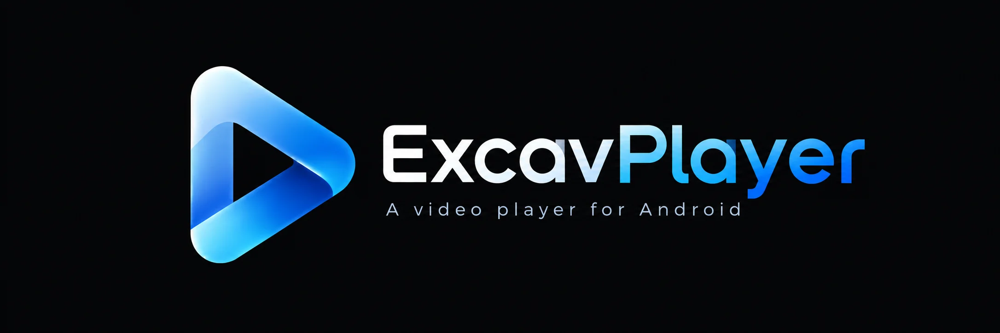
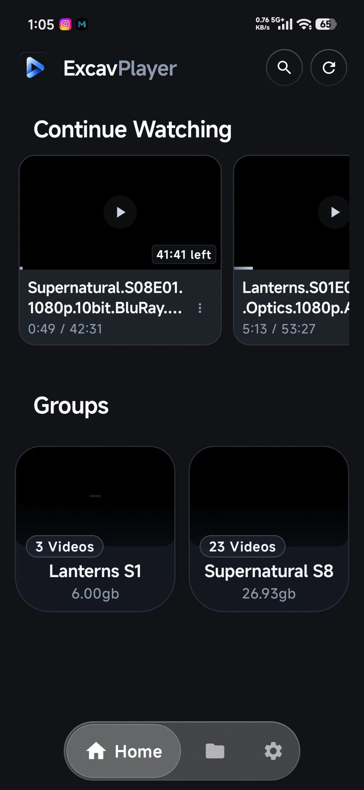
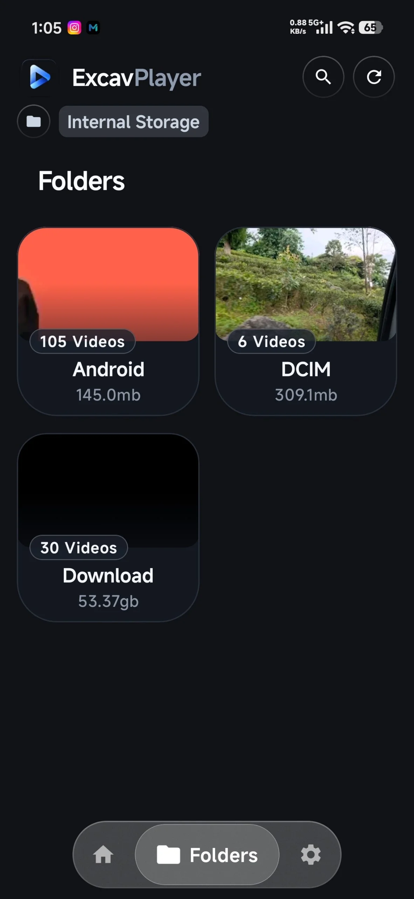
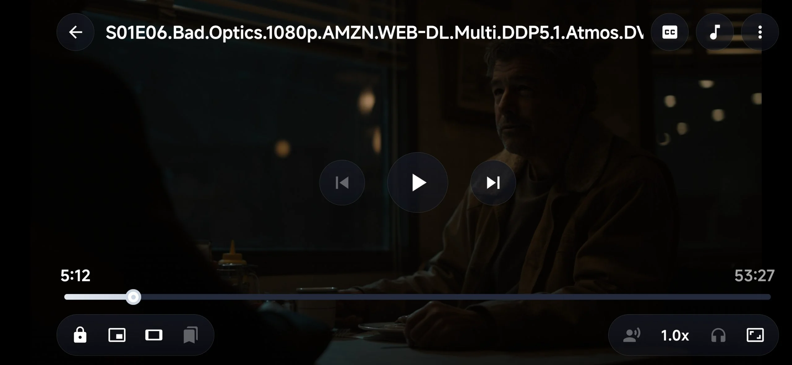
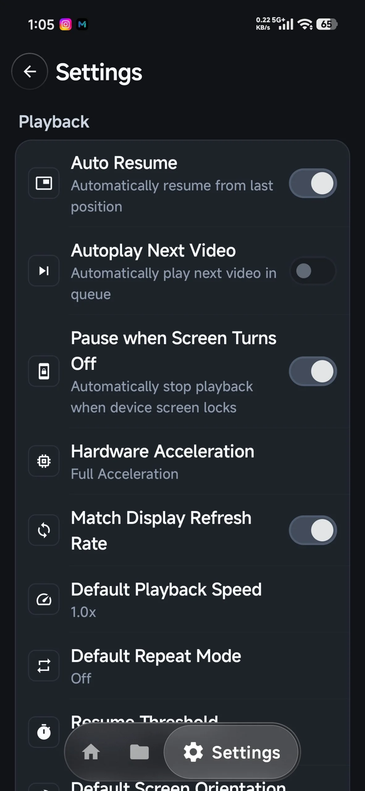

# ExcavPlayer

A modern, sleek Android video player designed for effortless media playback, fluid gesture controls, and a refined glassmorphic aesthetic. Built for high performance, distraction-free viewing, completely offline and complete privacy with zero ads or tracking.

## Tech Stack

- **Language:** Kotlin
- **UI Framework:** Jetpack Compose
- **Media Engine:** AndroidX Media3 (ExoPlayer, MediaSession, Decoder Extensions)
- **Architecture:** MVVM with Kotlin Coroutines & StateFlow
- **Dependency Injection:** Dagger Hilt
- **Local Persistence:** Room Database & Preferences DataStore
- **Background Tasks:** AndroidX WorkManager

  

## Screenshots

  
  
  
  

## Features

- **High-Performance Video Playback:** Hardware-accelerated media engine powered by AndroidX Media3 ExoPlayer supporting modern container formats and codecs.
- **Intuitive Touch Gestures:** On-screen vertical swipe controls for brightness and volume, horizontal scrubbing for fast-forward and rewind, and double-tap seeking.
- **Background Audio & Interactive Pill:** Continue playback with the screen off or app minimized, featuring a dynamic soundwave pill with quick play/pause controls.
- **5-Band Equalizer & Bass Boost:** Integrated audio equalizer with customizable frequency bands, presets, and hardware bass boost.
- **Comprehensive Subtitle Customization:** Personalize subtitle text size, color, background, and borders, with subtitle delay slider.
- **Library Browser:** Fast folder and video navigation with search, breadcrumb navigation.
- **Watch Timer:** Added continue watching tabs for recent watched videos.
